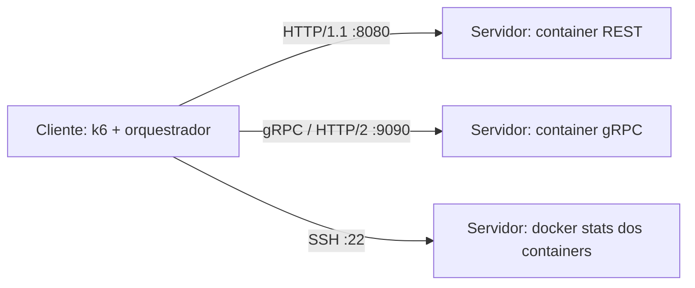

This undergraduate research project compares REST/JSON and gRPC/Protocol Buffers.
It benchmarks logistics inventory aggregation from 1,000 to 100,000 records.
A separate client generates load and collects server container metrics over SSH.

# Benchmark de inventário: REST vs gRPC

Código de TCC que compara REST (JSON sobre HTTP/1.1) e gRPC (Protocol Buffers
sobre HTTP/2) na agregação de inventário logístico. O objetivo é medir latência,
throughput, CPU e memória em diferentes volumes. Cada requisição lê o JSON do
disco, desserializa os dados e produz a resposta; no gRPC há também conversão
para as mensagens Protobuf. Não há banco de dados.

## Topologia



O experimento usa duas máquinas na mesma LAN. O k6 roda no cliente para não
competir pelos recursos medidos no servidor. A coleta começa antes do k6 e
termina depois dele; a janela não depende da comparação dos relógios das máquinas.

## Estrutura

```text
cmd/                 Gerador e servidores Go
internal/            Modelo de inventário e resolução dos datasets
proto/inventory.proto Contrato protobuf
proto/pb/            Stubs Go gerados, preservados sem edição manual
data/                Quatro datasets gerados, ignorados pelo Git
docker/              Dockerfiles dos três executáveis
docker-compose.yml   Serviços do servidor e volume compartilhado
k6/                  Cenários REST e gRPC
orchestrator/        Configuração, SSH, coleta e consolidação do CSV
analysis/            Análise estatística e gráficos
results/             results.csv e analysis_output/ quando disponíveis
marks/               Notas acadêmicas anteriores à implementação
```

As notas em `marks/` incluem decisões antigas (como a proposta Java) e referências
bibliográficas; não substituem o código Go nem constituem resultados deste benchmark.

## Pré-requisitos

- Servidor: Docker e Docker Compose. No Windows, Docker Desktop com backend WSL2,
  WSL Integration ativada e SSH executando dentro da distribuição WSL.
- Cliente: k6, Python 3.9+ e acesso SSH ao servidor. `grpcurl` é opcional.
- Go 1.22+ para gerar dados localmente, recompilar ou regenerar stubs.
  O Compose gera os dados no servidor sem exigir Go instalado no host.
- Para regenerar stubs: `protoc`, `protoc-gen-go` e `protoc-gen-go-grpc` no PATH.

Após `git clone`, entre na pasta clonada e execute os comandos abaixo a partir
da raiz, exceto onde indicado. O nome da pasta ou do repositório não importa:
o módulo é `inventory-benchmark`, conforme `go.mod`. Não altere esse module path.

## Início rápido em uma máquina

Este é um teste funcional local; as medições do experimento exigem duas máquinas.

```sh
go run ./cmd/datagen
docker compose up -d --build
curl -s http://localhost:8080/healthz
curl -s 'http://localhost:8080/api/v1/inventory?size=1000'
grpcurl -plaintext localhost:9090 list
grpcurl -plaintext -d '{"limit":1000}' localhost:9090 inventory.InventoryService/AggregateInventory
k6 run --env SIZE=1000 --env VUS=1 --env DURATION=5s --env BASE_URL=http://localhost:8080 k6/rest_test.js
k6 run --env SIZE=1000 --env VUS=1 --env DURATION=5s --env GRPC_ADDR=localhost:9090 k6/grpc_test.js
```

A resposta REST deve conter `total_count: 1000`; o serviço listado é
`inventory.InventoryService`. O Compose usa seu próprio volume `inventory-data`:
os arquivos em `data/` do host não são montados nele.

## Experimento em duas máquinas

1. No servidor, entre na raiz desta cópia do projeto e inicie os containers:

   ```sh
   docker compose up -d --build
   docker compose ps
   ```

   Libere no firewall as portas TCP 22, 8080 e 9090 para o cliente na LAN.
   No WSL, confirme que o IP e o encaminhamento das portas permitem acesso pelo
   cliente. O SSH precisa oferecer shell Linux com Bash, `setsid`, `nohup`,
   `date`, `sleep` e acesso ao comando `docker` sem sudo interativo. Mantenha
   apenas uma instância por serviço: o coletor resolve containers pelos labels
   `com.docker.compose.service`.

2. No cliente, crie uma chave dedicada e instale a chave pública no servidor.
   Substitua os placeholders nos comandos antes de executar:

   ```sh
   ssh-keygen -t ed25519 -f ~/.ssh/id_benchmark -C benchmark
   ssh-copy-id -i ~/.ssh/id_benchmark.pub '<SSH_USER>@<SERVER_IP>'
   ssh -i ~/.ssh/id_benchmark '<SSH_USER>@<SERVER_IP>' 'docker ps'
   ```

   A execução automatizada precisa conseguir abrir a chave sem prompt. Proteja
   a chave privada e use uma conta dedicada. Nunca publique a chave ou a
   configuração real. `<SSH_KEY_PATH>` representa o caminho local da chave;
   o exemplo usa `~/.ssh/id_benchmark`.

3. Ainda na raiz do projeto no cliente, prepare o Python:

   ```sh
   python3 -m venv .venv
   . .venv/bin/activate
   pip install -r orchestrator/requirements.txt
   cp orchestrator/config.example.yaml orchestrator/config.yaml
   ```

   Edite `orchestrator/config.yaml`: preencha `<SERVER_IP>` em `ssh.host` e nos
   dois `target_value`, `<SSH_USER>` e `key_path`. O IP deve ser acessível pelo
   cliente. Preserve volumes, duração e demais parâmetros da bateria.
   O arquivo real é ignorado pelo Git.

4. Execute o orquestrador **de dentro de `orchestrator/`**. Primeiro faça um teste
   reduzido (este teste já usa SSH e deve ser feito por quem executar o experimento):

   ```sh
   cd orchestrator
   python main.py --config config.yaml --only rest --sizes 1000 --repetitions 1
   ```

5. Para a bateria completa, no mesmo diretório:

   ```sh
   python main.py --config config.yaml
   ```

   Reserve cerca de 30–35 minutos; falhas, inicialização e rede podem aumentar o
   tempo. São 40 casos: dois protocolos, quatro volumes e cinco repetições.
   O exemplo grava `../results/results.csv` e os intermediários em
   `../results/raw/` (ignorados). Cada execução sobrescreve o consolidado:
   preserve externamente uma execução anterior antes de repetir. Confira 40
   linhas, combinações únicas, `k6_success`, checks e `stats_sample_count` antes
   de usar os dados. Ter 40 linhas, por si só, não garante medições válidas.

## Análise

Na raiz do projeto, com o ambiente virtual ativado e um CSV real disponível:

```sh
pip install -r analysis/requirements.txt
python analysis/analysis.py --input results/results.csv --output-dir results/analysis_output
```

São produzidos `summary_table.csv`, `summary_table.md`, gráficos
`chart_<metrica>.png` e `dashboard.png`. A análise calcula médias, desvios-padrão
e teste t de Welch por volume e métrica. Confira a qualidade do CSV antes de
interpretar as saídas.

## Regeneração dos stubs

Os arquivos em `proto/pb/` são gerados. Para regenerar deliberadamente a partir
do contrato, na raiz (as versões abaixo correspondem aos cabeçalhos atuais):

```sh
go install google.golang.org/protobuf/cmd/protoc-gen-go@v1.36.12
go install google.golang.org/grpc/cmd/protoc-gen-go-grpc@v1.6.2
export PATH="$(go env GOPATH)/bin:$PATH"
protoc --go_out=. --go_opt=module=inventory-benchmark --go-grpc_out=. --go-grpc_opt=module=inventory-benchmark proto/inventory.proto
```

Preserve `go_package = "inventory-benchmark/proto/pb;pb"`. Os stubs atuais registram `protoc` 3.21.12. Os plugins atuais podem exigir
um Go mais recente que 1.22; use a versão requerida pelo plugin ao regenerar.

## Parâmetros implementados

| Parâmetro | Valor padrão |
|---|---|
| Volumes | 1.000, 10.000, 50.000 e 100.000 registros |
| VUs | 10 |
| Duração por caso | 30 s |
| Repetições no orquestrador | 5 |
| Cooldown entre casos | 10 s |
| Espera entre coletas docker stats | 1 s, além do tempo da chamada |
| Graceful stop do k6 | 5 s |
| Limites configurados de mensagem gRPC | 64 MiB no servidor e no cliente k6 |
| Seed do gerador | 42, somada ao volume |
| Data-base do gerador | 2026-07-01 00:00:00 UTC |

O k6 aceita `SIZE`, `VUS`, `DURATION`, `GRACEFUL_STOP` e `MAX_MESSAGE_SIZE`.
REST aceita `BASE_URL`; gRPC aceita `GRPC_ADDR`. Sem `SIZE`, os scripts criam
cenários sequenciais para os quatro volumes; o orquestrador sempre fornece
`SIZE` para medir um volume por janela. Os servidores aceitam `-addr` e `-data`.

## Limitações conhecidas

Transporte e serialização variam juntos (REST/HTTP1.1 vs gRPC/HTTP2); seus efeitos
não são isolados. Não há TLS. Com poucas requisições completas por janela,
p95/p99 em volumes altos são pouco informativos. Resultados dependem do hardware
e da rede, inclusive da capacidade do cliente de gerar e processar carga.

## Solução de problemas

| Sintoma | Verificação |
|---|---|
| gRPC trava sem erro | Confira IP, firewall e acesso TCP à porta 9090. |
| `ResourceExhausted: received message larger than max` | O limite padrão de recebimento é 4 MiB; amplie o limite no cliente ou servidor que rejeitou a mensagem. Os componentes deste projeto configuram 64 MiB. |
| Zero checks ou `No script iterations fully finished` | Alvo inalcançável ou volume pesado demais para a janela; confira endereço e portas e valide primeiro com 1.000 registros. |
| `docker` não encontrado no WSL | Ative WSL Integration no Docker Desktop para a distribuição usada pelo SSH. |
| `missing go.sum entry` | Na raiz, execute `go mod tidy`. |
| REST com 100 mil registros sem memória | Disponibilize pelo menos 4 GB de RAM livres no servidor. |
| Build Docker não encontra dependência | Os Dockerfiles atuais executam `go mod tidy` antes de copiar os fontes; isso pode remover dependências antes do build. A ordem foi preservada nesta limpeza e precisa de correção separada antes do uso se o build falhar. |

## Resultados disponíveis

`results/` é o destino dos resultados consolidados e da análise. Esta cópia não
inclui `results/results.csv` nem `results/analysis_output/`; não são apresentados
números ou conclusões de desempenho. Publique somente uma execução completa e
revisada. Em CSVs antigos, `latency_p99_or_max_ms` contém o **máximo**, não o p99;
a análise trata essa coluna como `latency_max_ms` sem modificar o CSV de entrada.

## Licença e autoria

Licença MIT, em `LICENSE` (tradução em português). Autor: `<AUTOR>`.
Orientação: `<ORIENTADOR>`. Instituição: `<INSTITUICAO>`.
Conta de publicação no GitHub: `<GITHUB_USER>`. Preencha esses campos antes de
publicar e revise também as notas acadêmicas em `marks/`.
